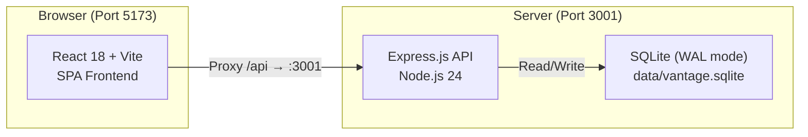
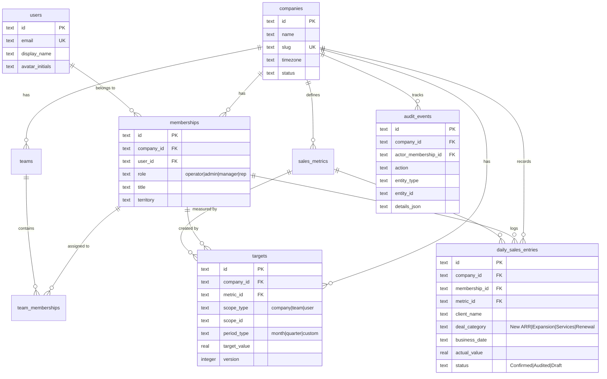

# Vantage Sales Target Platform — Complete User Guide & System Audit

> [!NOTE]
> This guide covers the full architecture, every feature, role-based access rules, all API endpoints, keyboard shortcuts, troubleshooting, and operational commands for the Vantage platform.

---

## Table of Contents

1. [Architecture Overview](#1-architecture-overview)
2. [How to Start the Application](#2-how-to-start-the-application)
3. [Roles & Persona Switching](#3-roles--persona-switching)
4. [Pages & Features Walkthrough](#4-pages--features-walkthrough)
5. [Modals & Actions](#5-modals--actions)
6. [API Endpoints Reference](#6-api-endpoints-reference)
7. [Database Schema & Data Model](#7-database-schema--data-model)
8. [Domain Calculations Engine](#8-domain-calculations-engine)
9. [Security & Multi-Tenant Isolation](#9-security--multi-tenant-isolation)
10. [Audit Trail System](#10-audit-trail-system)
11. [Test Suite](#11-test-suite)
12. [Keyboard Shortcuts](#12-keyboard-shortcuts)
13. [Troubleshooting & Log Commands](#13-troubleshooting--log-commands)
14. [Quick Reference Command Sheet](#14-quick-reference-command-sheet)

---

## 1. Architecture Overview

Vantage is a **modular monolith** with clear client/server separation:



| Layer | Technology | Key Files |
|-------|-----------|-----------|
| **Frontend** | React 18, TypeScript, Vite, Lucide Icons | [`src/client/`](file:///c:/Users/adity/Desktop/sales-target-platform-docs/src/client) |
| **Backend** | Express 4, TypeScript, Zod validation | [`src/server/`](file:///c:/Users/adity/Desktop/sales-target-platform-docs/src/server) |
| **Database** | Node.js built-in SQLite (`node:sqlite`), WAL mode | [`data/vantage.sqlite`](file:///c:/Users/adity/Desktop/sales-target-platform-docs/data) |
| **Tests** | Vitest + Supertest (14 tests across 3 files) | [`src/tests/`](file:///c:/Users/adity/Desktop/sales-target-platform-docs/src/tests) |

### Request Flow

```
Browser Request → Vite Dev Proxy (:5173) → Express (:3001)
                                              ↓
                                     Auth Middleware (resolve membership from x-membership-id header)
                                              ↓
                                     Tenant Guard (companyId must match caller's membership)
                                              ↓
                                     RBAC Guard (requireRole for write operations)
                                              ↓
                                     Route Handler → SQLite → JSON Response
                                              ↓
                                     Audit Event recorded (for mutations)
```

---

## 2. How to Start the Application

> [!IMPORTANT]
> You need **two terminal windows** running simultaneously for development.

### Development Mode (Recommended)

**Terminal 1 — Backend API Server:**
```powershell
npm run dev:server
```
Starts the Express API on **port 3001** with auto-restart via `tsx watch`.

**Terminal 2 — Frontend Dev Server:**
```powershell
npm run dev
```
Starts Vite on **port 5173** with HMR. Proxies all `/api/*` requests to `:3001`.

**Open in browser:** [http://localhost:5173](http://localhost:5173)

### Production Mode

```powershell
npm run build    # TypeScript check + Vite production build → dist/
npm start        # Serves API + static dist/ on port 3001
```
**Open in browser:** [http://localhost:3001](http://localhost:3001)

### First-Time Setup

```powershell
npm install                  # Install dependencies
copy .env.example .env       # Create environment config
npm run dev:server           # Auto-runs migrations + seeds on first launch
```

The database auto-creates on first server start:
- Schema migrations run automatically via [`runMigrations()`](file:///c:/Users/adity/Desktop/sales-target-platform-docs/src/server/db/migrations.ts#L140-L160)
- Seed data inserts automatically via [`seedDatabase()`](file:///c:/Users/adity/Desktop/sales-target-platform-docs/src/server/db/seed.ts#L5-L236)

### Reset / Re-seed Database

```powershell
Remove-Item .\data\vantage.sqlite    # Delete existing database
npm run dev:server                    # Restart — fresh seed data
```

---

## 3. Roles & Persona Switching

The platform has a **4-tier role hierarchy**:

| Role | Capabilities | Seeded Example |
|------|-------------|---------------|
| **Operator** | Platform-level super admin (reserved) | — |
| **Admin** | Full workspace control: invite members, set quotas, view all data, audit logs | Alex Mercer (`mem_alex`) |
| **Manager** | Team management: invite members, set quotas, view team data, audit logs | Sarah Kim (`mem_sarah`) |
| **Rep** | Self-only: log own sales, view own portal, cannot invite or set quotas | Priya Singh (`mem_priya`), Marcus Vance (`mem_marcus`) |

### How Persona Switching Works

The app includes a **built-in persona switcher** in the top navbar (the `Role: ADMIN (Alex)` button). This is a demo/testing feature that lets you experience the platform from different user perspectives without logging out.

**What happens when you switch:**
1. The selected membership ID is stored in `localStorage` as `vantage_membership_id`
2. Every API request sends this ID as the `x-membership-id` header
3. The server resolves the full user/company/team context from this membership
4. The UI re-renders with that user's permissions and data scope

### Seeded Demo Companies

| Company | ID | Users |
|---------|-------|-------|
| **Acme Corp** | `company_acme` | 17 reps + Alex (admin) + Sarah (manager) |
| **Beta Dynamics** | `company_beta` | 1 user (Beta Admin) — for cross-tenant isolation testing |

### Seeded Key People at Acme Corp

| Name | Membership ID | Role | Team | Quota Target |
|------|-------------|------|------|-------------|
| Alex Mercer | `mem_alex` | Admin | Mid-Market | $180,000 |
| Sarah Kim | `mem_sarah` | Manager | Enterprise | $250,000 |
| Priya Singh | `mem_priya` | Rep | Enterprise | $220,000 |
| Elena Rostova | `mem_elena` | Rep | Enterprise | $200,000 |
| John Doe | `mem_john` | Rep | Mid-Market | $150,000 |
| Marcus Vance | `mem_marcus` | Rep | Mid-Market | $160,000 |

> [!TIP]
> Marcus Vance is intentionally seeded with **$0 sales today** — he triggers the "Immediate Attention" alert on the Executive Overview dashboard.

---

## 4. Pages & Features Walkthrough

### 4.1 Executive Overview (`overview`)

**File:** [`ExecutiveOverview.tsx`](file:///c:/Users/adity/Desktop/sales-target-platform-docs/src/client/pages/ExecutiveOverview.tsx)
**API:** `GET /api/v1/workspaces/:workspaceId/analytics/overview`

The company-wide dashboard showing:

| Section | What It Shows |
|---------|--------------|
| **4 KPI Cards** | Total Closed Revenue (vs target, attainment %), Target Delta Gap (remaining $, days left, required $/day), Burn Run Pace (daily pace + buffer %), Submission Health (% reps submitted today) |
| **Immediate Attention Alert** | Red banner if any rep has zero submissions today (triggers for Marcus Vance by default) |
| **Target Realization by Segment** | Enterprise vs Mid-Market team comparison with progress bars |
| **Attainment Velocity Chart** | Week-by-week cadence showing actual vs target daily output |
| **Rep Attainment Leaderboard** | Sorted table of all reps with quota, closed amount, attainment %, and status badges (Ahead / On Track / Needs Nudge) |
| **Recent Closes Live Feed** | Last 5 confirmed deals across the company |
| **Action Buttons** | "+ Log Sales", "+ Invite Rep", "⚙ Manage Quotas" — each opens its respective modal |

### 4.2 Sales Rep Portal (`rep-portal`)

**File:** [`SalesRepPortal.tsx`](file:///c:/Users/adity/Desktop/sales-target-platform-docs/src/client/pages/SalesRepPortal.tsx)
**API:** `GET /api/v1/workspaces/:workspaceId/analytics/rep-portal`

The individual salesperson's personal dashboard:

| Section | What It Shows |
|---------|--------------|
| **4 KPI Cards** | Today's Sales Logged (vs daily target), Month-to-Date Closed (vs monthly quota), Projected Month-End, Win Entry Rate (consecutive on-time days) |
| **7-Day Output Chart** | Bar chart showing daily deal amounts for the last 7 days with benchmark line |
| **Pacing Surplus Panel** | Nominal delta, rolling cadence, threshold day, tier qualification status |
| **Commission Pacing Track** | Visual progress toward 75% Base → 100% Quota → 125% Super Accelerator tiers |
| **Compliance Checklist** | Midday Sync Logged, Reconcile Pending Draft, EOD Affirmation Sign-off items |
| **Recent Entries Table** | Last 5 confirmed entries with client name, category, amount, date |
| **Pending Drafts** | Uncommitted transactions awaiting contract attachment / confirmation |

### 4.3 Team Page (`team`)

**File:** [`TeamPage.tsx`](file:///c:/Users/adity/Desktop/sales-target-platform-docs/src/client/pages/TeamPage.tsx)
**API:** `GET /api/v1/workspaces/:workspaceId/members`

Lists all workspace members with:
- Name, email, role badge, title, team assignment, territory
- "+ Invite Team Member" button (admin/manager only)

### 4.4 Targets Page (`targets`)

**File:** [`TargetsPage.tsx`](file:///c:/Users/adity/Desktop/sales-target-platform-docs/src/client/pages/TargetsPage.tsx)
**API:** `GET /api/v1/workspaces/:workspaceId/targets`

Shows all active quota targets across scopes:
- **Company-level** targets (e.g., Acme Corp $1.6M for April)
- **Team-level** targets (e.g., Enterprise $1M, Mid-Market $600K)
- **User-level** targets (individual rep quotas)
- Each row shows scope, metric, target value, period dates, created by

### 4.5 Audit Log (`audit`)

**File:** [`AuditLogPage.tsx`](file:///c:/Users/adity/Desktop/sales-target-platform-docs/src/client/pages/AuditLogPage.tsx)
**API:** `GET /api/v1/workspaces/:workspaceId/audit-events`
**Access:** Admin & Manager only

Immutable chronological log of all business-critical actions:
- `WORKSPACE_INITIALIZED`, `MEMBER_INVITED`, `SALES_ENTRY_CREATED`, `SALES_ENTRY_CONFIRMED`, `TARGET_CREATED`
- Each event shows: actor name, action, entity type, timestamp, request ID, and JSON details

### 4.6 Settings (`settings`)

Displays basic workspace configuration:
- Company name, timezone, status
- Sales cutoff auto-lock note (18:00 EST)

### 4.7 Reports (`reports`)

Currently mirrors the Executive Overview dashboard (same component reused).

---

## 5. Modals & Actions

### 5.1 Log Sales Deal Modal

**Component:** [`SalesLoggerModal.tsx`](file:///c:/Users/adity/Desktop/sales-target-platform-docs/src/client/components/SalesLoggerModal.tsx)
**Trigger:** "+ Log Sales" button (navbar, sidebar, overview page) or `Ctrl+L`

| Field | Description | Required |
|-------|------------|----------|
| Deal & Client Name | Free text (e.g., "Linear Orbit Inc.") | ✅ |
| Deal Category | Dropdown: New ARR, Expansion, Services, Renewal | ✅ |
| Amount ($ USD) | Positive number, 2 decimal places | ✅ |
| Business Date | Date picker, defaults to today | ✅ |
| Notes & Contract Ref | Free text, max 500 chars | ❌ |
| Save as Draft | Checkbox — drafts don't count toward live pacing | ❌ |

**Backend flow:**
1. Validates via Zod schema ([`entryCreateSchema`](file:///c:/Users/adity/Desktop/sales-target-platform-docs/src/server/routes/salesEntries.ts#L74-L83))
2. IDOR guard: reps cannot log sales under another rep's `membershipId`
3. Wraps insert in a database transaction
4. Records `SALES_ENTRY_CREATED` audit event
5. Returns `201 Created` with the new entry

### 5.2 Invite Team Member Modal

**Component:** [`InviteRepModal.tsx`](file:///c:/Users/adity/Desktop/sales-target-platform-docs/src/client/components/InviteRepModal.tsx)
**Access:** Admin & Manager only

| Field | Options |
|-------|---------|
| Full Name | Free text |
| Work Email | Email validation |
| Role | Sales Representative, Team Manager, Company Admin |
| Assigned Team | Enterprise (ENT), Mid-Market (MM) |
| Job Title | Free text |
| Territory | Free text (optional) |

**Backend flow:**
1. Creates or reuses existing user by email
2. Creates new membership (enforces unique company+user constraint)
3. Assigns to selected team
4. Records `MEMBER_INVITED` audit event

### 5.3 Manage Quota Targets Modal

**Component:** [`ManageQuotasModal.tsx`](file:///c:/Users/adity/Desktop/sales-target-platform-docs/src/client/components/ManageQuotasModal.tsx)
**Access:** Admin & Manager only

| Field | Options |
|-------|---------|
| Quota Target Scope | Entire Company, Team Level, Individual Rep |
| Select Team/Rep | Conditional dropdown based on scope |
| Target Amount ($ USD) | Positive number, min $1,000 |
| Period Start/End | Date pickers |

---

## 6. API Endpoints Reference

All endpoints are prefixed with `/api/v1`. Every request goes through the [`authenticate`](file:///c:/Users/adity/Desktop/sales-target-platform-docs/src/server/middleware/auth.ts#L50-L143) middleware.

### Authentication & Identity

| Method | Endpoint | Auth | Description |
|--------|---------|------|-------------|
| `GET` | `/auth/me` | Any | Returns current user, membership, company, and all available personas for switching |

### Workspace & Members

| Method | Endpoint | Auth | Description |
|--------|---------|------|-------------|
| `GET` | `/workspaces/:id` | Any | Workspace details with metrics and teams |
| `GET` | `/workspaces/:id/members` | Any | List all workspace members |
| `POST` | `/workspaces/:id/members/invite` | Admin, Manager | Invite new member (creates user + membership + team assignment) |
| `GET` | `/workspaces/:id/teams` | Any | List teams with member counts |

### Sales Entries

| Method | Endpoint | Auth | Description |
|--------|---------|------|-------------|
| `GET` | `/workspaces/:id/sales-entries` | Any (reps see only own) | List entries with filters: `membershipId`, `from`, `to`, `status`, `category` |
| `POST` | `/workspaces/:id/sales-entries` | Any (rep: own only) | Create new daily sales entry (transactional) |
| `POST` | `/workspaces/:id/sales-entries/:entryId/confirm` | Any | Promote Draft → Confirmed status |

### Targets / Quotas

| Method | Endpoint | Auth | Description |
|--------|---------|------|-------------|
| `GET` | `/workspaces/:id/targets` | Any | List all active targets with optional `scopeType`, `periodStart`, `periodEnd` filters |
| `POST` | `/workspaces/:id/targets` | Admin, Manager | Create new quota target for company/team/user scope |

### Analytics (Read-Only)

| Method | Endpoint | Auth | Description |
|--------|---------|------|-------------|
| `GET` | `/workspaces/:id/analytics/overview` | Any | Full executive dashboard data |
| `GET` | `/workspaces/:id/analytics/rep-portal` | Any | Individual rep portal data (optional `?membershipId=` to view specific rep) |

### Audit

| Method | Endpoint | Auth | Description |
|--------|---------|------|-------------|
| `GET` | `/workspaces/:id/audit-events` | Admin, Manager | Paginated audit trail with optional `entityType` filter |

### System

| Method | Endpoint | Auth | Description |
|--------|---------|------|-------------|
| `GET` | `/health` | None | Health check (`{ status: 'ok', timestamp: '...' }`) |

### Error Response Format (RFC-style)

All errors follow a consistent structure:
```json
{
  "error": {
    "code": "FORBIDDEN",
    "message": "Access denied to this workspace.",
    "requestId": "req_1729...abc",
    "details": []
  }
}
```

Error codes: `VALIDATION_ERROR` (400), `UNAUTHENTICATED` (401), `FORBIDDEN` (403), `NOT_FOUND` (404), `CONFLICT` (409), `INTERNAL_ERROR` (500).

---

## 7. Database Schema & Data Model

**Schema file:** [`migrations.ts`](file:///c:/Users/adity/Desktop/sales-target-platform-docs/src/server/db/migrations.ts#L10-L137)



### Key Invariants

- **Tenant isolation**: Every table includes `company_id`. All queries filter by the caller's company.
- **Unique constraints**: `(company_id, user_id)` on memberships, `(company_id, code)` on teams and metrics
- **Value constraints**: `target_value >= 0`, `actual_value >= 0`, role must be one of `operator|admin|manager|rep`
- **Deal categories**: Exactly one of `New ARR`, `Expansion`, `Services`, `Renewal`
- **Entry statuses**: `Draft` (uncommitted, excluded from pacing), `Confirmed` (counted in live totals), `Audited` (verified by management)

---

## 8. Domain Calculations Engine

**File:** [`calculations.ts`](file:///c:/Users/adity/Desktop/sales-target-platform-docs/src/server/domain/calculations.ts)

### 8.1 Pacing Metrics (`calculatePacingMetrics`)

Given `totalTarget`, `actualClosed`, `totalBusinessDays`, and `elapsedBusinessDays`:

| Output | Formula |
|--------|---------|
| `attainmentPercent` | `(actualClosed / totalTarget) × 100` |
| `gap` | `max(0, totalTarget − actualClosed)` |
| `remainingBusinessDays` | `totalBusinessDays − elapsedBusinessDays` |
| `runPacePerDay` | `actualClosed / max(1, elapsedBusinessDays)` |
| `requiredPacePerDay` | `gap / remainingBusinessDays` (0 if no days left) |
| `projectedPeriodEnd` | `runPacePerDay × totalBusinessDays` |
| `pacingBufferPercent` | `((runPace − requiredPace) / requiredPace) × 100` |
| `pacingStatus` | Buffer ≥ +20% = **Ahead**, ≥ −5% = **On Track**, ≥ −25% = **Needs Nudge**, else = **Lagging** |

### 8.2 Submission Health (`calculateSubmissionHealth`)

| Output | Formula |
|--------|---------|
| `healthPercent` | `(submittedCount / totalActiveReps) × 100` |
| `pendingCount` | `totalActiveReps − submittedCount` |
| `alertLevel` | 0 pending = **Normal**, 1-3 = **Warning**, 4+ = **Critical** |

### 8.3 Target Resolution Hierarchy

**File:** [`targetResolver.ts`](file:///c:/Users/adity/Desktop/sales-target-platform-docs/src/server/domain/targetResolver.ts)

When resolving a rep's quota, the system uses a **cascading fallback**:

```
1. User-specific target (scope_type = 'user', scope_id = membership_id)
        ↓ not found?
2. Team target (scope_type = 'team', scope_id = rep's team_id)
        ↓ not found?
3. Company default target (scope_type = 'company')
        ↓ not found?
4. Returns null
```

---

## 9. Security & Multi-Tenant Isolation

### 9.1 Authentication ([`auth.ts`](file:///c:/Users/adity/Desktop/sales-target-platform-docs/src/server/middleware/auth.ts))

- Every request gets a unique `requestId` (from `x-request-id` header or auto-generated)
- Membership is resolved from `x-membership-id` header or defaults to the first active admin
- Cross-tenant guard: if `x-company-id` header is provided, it must match the membership's company

### 9.2 Authorization ([`authorize.ts`](file:///c:/Users/adity/Desktop/sales-target-platform-docs/src/server/middleware/authorize.ts))

- `requireRole('admin', 'manager')` middleware blocks reps from:
  - Inviting members (`POST /members/invite`)
  - Creating targets (`POST /targets`)
  - Viewing audit logs (`GET /audit-events`)

### 9.3 IDOR Prevention

- **Sales entry impersonation guard**: Reps cannot submit `membershipId` pointing to another user — the server checks `targetMembershipId !== req.membership.id` and returns 403
- **Workspace boundary**: Every route handler calls `checkTenant(req, workspaceId)` to verify the caller's `companyId` matches the requested workspace

### 9.4 Input Validation

- All mutation endpoints use **Zod schemas** for strict input validation
- Negative monetary values are rejected at the schema level (`z.number().positive()`)
- Email format, minimum string lengths, and enum constraints are enforced server-side

---

## 10. Audit Trail System

Every business-critical mutation automatically records an immutable audit event via [`recordAuditEvent()`](file:///c:/Users/adity/Desktop/sales-target-platform-docs/src/server/middleware/authorize.ts#L32-L62):

| Action | Trigger |
|--------|---------|
| `WORKSPACE_INITIALIZED` | Database seed |
| `MEMBER_INVITED` | New member invitation |
| `SALES_ENTRY_CREATED` | Deal logged (including drafts) |
| `SALES_ENTRY_CONFIRMED` | Draft promoted to Confirmed |
| `TARGET_CREATED` | New quota target set |

Each event stores:
- **Who**: `actor_membership_id` + actor's name, email, role (resolved via JOIN)
- **What**: `action`, `entity_type`, `entity_id`
- **When**: `occurred_at` (ISO 8601 timestamp)
- **Context**: `request_id` for correlation, `details_json` with structured data
- **Where**: `company_id` for tenant scoping

---

## 11. Test Suite

**14 automated tests** across 3 files, run with `npm test`:

### [`calculations.test.ts`](file:///c:/Users/adity/Desktop/sales-target-platform-docs/src/tests/calculations.test.ts) — 6 tests

| Test | Validates |
|------|----------|
| Attainment and gap correctly | Core pacing math with real numbers ($1.6M target, $1.42M closed) |
| Zero target gracefully | No division-by-zero on `attainmentPercent` when target = 0 |
| Zero elapsed days | Safe `runPacePerDay` when period just started |
| Health % and alert level | 16/17 submitted = 94.1%, Warning level |
| 100% submitted | Normal alert level, 0 pending |
| Daily benchmark | $85K / 20 days = $4,250 |

### [`security.test.ts`](file:///c:/Users/adity/Desktop/sales-target-platform-docs/src/tests/security.test.ts) — 5 tests

| Test | Validates |
|------|----------|
| Cross-tenant access blocked | Acme user → Beta workspace = 403 |
| Own workspace permitted | Acme user → Acme workspace = 200 |
| Rep cannot invite members | Rep role → invite endpoint = 403 |
| IDOR: rep cannot log for another rep | Priya → Marcus's membershipId = 403 |
| Negative monetary values rejected | `-$500` deal = 400 Validation Error |

### [`sales.test.ts`](file:///c:/Users/adity/Desktop/sales-target-platform-docs/src/tests/sales.test.ts) — 3 tests

| Test | Validates |
|------|----------|
| Rep can log valid daily deal | Full lifecycle: create entry → 201 + correct data |
| Entry appears in rep ledger | GET entries returns the newly created entry |
| Confirming a draft sale | Draft → Confirmed status transition |

---

## 12. Keyboard Shortcuts

| Shortcut | Action |
|----------|--------|
| `Ctrl + L` (or `⌘ + L`) | Open the Sales Logger modal from anywhere |

---

## 13. Troubleshooting & Log Commands

### Server Won't Start — `EADDRINUSE`

The error you just saw: port 3001 is already occupied by another process.

```powershell
# Find and kill the process using port 3001
netstat -ano | findstr ":3001"
taskkill /PID <PID_NUMBER> /F

# Then restart
npm start
```

### Stream Server Logs to a File

```powershell
# Pipe server output to both console and file
npm run dev:server 2>&1 | Tee-Object -FilePath server.log

# Tail the log file in real-time
Get-Content -Path .\server.log -Tail 50 -Wait
```

### Frontend / Proxy Errors

- **Browser Console** (`F12` → Console tab): JavaScript errors, failed API calls
- **Browser Network** (`F12` → Network tab → Fetch/XHR): HTTP status codes and response bodies
- **Vite Terminal**: Proxy connection errors (e.g., `ECONNREFUSED` if backend is down)

### Database Inspection

```powershell
# Check if database exists and its size
Get-Item .\data\vantage.sqlite

# Complete reset (delete and let server re-seed)
Remove-Item .\data\vantage.sqlite
npm run dev:server
```

### Health Check

```powershell
# Quick backend health check
curl http://localhost:3001/health
# Expected: {"status":"ok","timestamp":"2026-10-20T..."}
```

### Run Tests

```powershell
npm test
# Expected: 3 test files, 14 tests passed
```

---

## 14. Quick Reference Command Sheet

| Command | Purpose |
|---------|---------|
| `npm install` | Install all dependencies |
| `npm run dev` | Start Vite frontend dev server (port 5173) |
| `npm run dev:server` | Start Express backend with auto-restart (port 3001) |
| `npm start` | Start production server (port 3001) |
| `npm run build` | TypeScript check + Vite production build |
| `npm test` | Run all 14 automated tests |
| `npm run db:migrate` | Run database migrations manually |
| `npm run db:seed` | Re-seed database manually |

### Environment Variables ([`.env`](file:///c:/Users/adity/Desktop/sales-target-platform-docs/.env))

| Variable | Default | Description |
|----------|---------|-------------|
| `PORT` | `3001` | Backend server port |
| `DATABASE_PATH` | `data/vantage.sqlite` | SQLite database file path |
| `NODE_ENV` | `development` | Environment mode |

---

> [!TIP]
> **For development**, always use `npm run dev:server` (not `npm start`) — it auto-restarts the backend on file changes. The `npm run dev` Vite server provides instant HMR for frontend changes.
